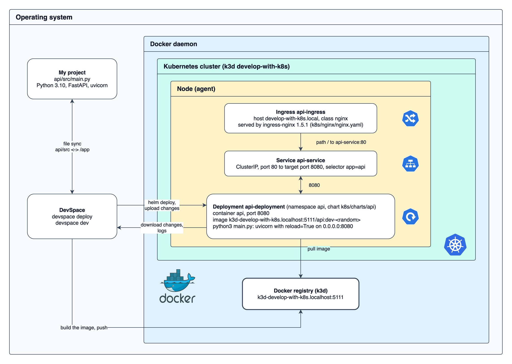

<p align="center">
  
</p>

<h1 align="center">develop-with-k8s-python</h1>

<p align="center">
  <strong>Edit a FastAPI route, save, and the pod behind the Ingress answers with the new code.</strong><br>
  A DevOps demonstration: a Python API deployed with Helm on a local k3d cluster, exposed through
  ingress-nginx and kept in sync by DevSpace while uvicorn reloads on every change.
</p>

<p align="center">
  <a href="#quick-start">Quick start</a> &middot;
  <a href="#how-it-works">How it works</a> &middot;
  <a href="#commands">Commands</a> &middot;
  <a href="#tech-stack">Tech stack</a> &middot;
  <a href="#documentation">Documentation</a>
</p>

<p align="center">
  
  
  
  
  
</p>

<p align="center">
  
  <br>
  <sub>DevSpace builds and pushes the image, installs the chart, then streams file changes both
  ways between <code>api/src</code> and the container.</sub>
</p>

---

Testing a change against Kubernetes usually takes minutes: build an image, push it, bump a tag,
wait for the rollout. This small demonstration repository shortens that loop to the time uvicorn
needs to restart.

**develop-with-k8s-python** creates a k3d cluster and a registry in Docker, installs ingress-nginx
so the API has a real hostname, and lets DevSpace drive the rest. DevSpace builds the image,
pushes it to the local registry, installs the Helm chart and then keeps `api/src` and the
container's `/app` in sync in both directions. The API runs `uvicorn` with `reload=True`, so
every saved file restarts the server inside the pod.

The API is a single FastAPI route that returns `{"message": "I am running !"}`. A sibling
repository, [develop-with-k8s-golang](https://github.com/verovec/develop-with-k8s-golang), does
the same with a Go API and air.

## Quick start

**Prerequisites:** Docker, [k3d](https://k3d.io), `kubectl`, Helm 3 and
[DevSpace](https://www.devspace.sh) 6.2.5 (the version pinned in `devspace.yaml`).

```bash
sudo -- sh -c "echo '127.0.0.1 develop-with-k8s.local' >> /etc/hosts"   # the Ingress host
git clone https://github.com/verovec/develop-with-k8s-python.git && cd develop-with-k8s-python
make start     # k3d registry on port 5111, one-agent cluster, ingress-nginx, namespace api
make deploy    # DevSpace builds the image, pushes it and installs the Helm chart
make dev       # redeploys, then syncs api/src into the pod and follows the logs
```

Open [http://develop-with-k8s.local/](http://develop-with-k8s.local/): ingress-nginx listens on
port 80 of the k3d load balancer. Edit `api/src/main.py`, save, and reload the page. `make all`
runs the three steps in one go; `make stop` pauses the cluster and `make cleanup` removes it with
the registry.

## How it works

```
  make start     cluster-init.sh: k3d registry, k3d cluster (traefik disabled, ports 80, 443
     |           and 4200), server node tainted, namespaces ingress-nginx and api,
     |           ingress-nginx 1.5.1 applied from k8s/nginx/nginx.yaml
  make deploy    devspace deploy: image built from api/Dockerfile (python:3.10, poetry install),
     |           tagged dev-<random>, pushed to the registry, chart k8s/charts/api installed
  make dev       devspace dev: api/src synced to /app in the api container, logs followed
     |
  uvicorn        python3 main.py starts uvicorn with reload=True; every saved file restarts it
     |
  Ingress        develop-with-k8s.local -> Service api-service:80 -> container port 8080
```

DevSpace swaps the image tag on every deploy (`dev-${DEVSPACE_RANDOM}`), so the Deployment pulls
the image it just pushed even though the registry is local.

## Commands

| Command | What it does |
|---------|--------------|
| `make start` | Create (or restart) the registry and the cluster, install ingress-nginx |
| `make deploy` | Build and push the image, install the chart (`devspace deploy`) |
| `make dev` | Deploy, then sync `api/src` and stream the logs (`devspace dev`) |
| `make api` | `deploy` then `dev` |
| `make all` | `start` then `api` |
| `make cleanup-images` | Delete the images DevSpace built |
| `make stop` | Stop the cluster and the registry container |
| `make delete` | Delete the cluster, keep the registry |
| `make cleanup` | Delete the cluster and the registry |

## Tech stack

| Layer | Tech | Location |
|-------|------|----------|
| API | Python 3.10, FastAPI 0.89, uvicorn 0.18 with `reload=True` | `api/src/main.py`, `api/pyproject.toml` |
| Image | `python:3.10`, dependencies installed with Poetry | `api/Dockerfile` |
| Cluster | k3d (k3s in Docker), local registry on port 5111 | `cluster-init.sh`, `Makefile` |
| Ingress controller | ingress-nginx 1.5.1, LoadBalancer on ports 80, 443 and 4200 | `k8s/nginx/nginx.yaml` |
| Deployment | Helm chart: Deployment, Service, Ingress, HPA | `k8s/charts/api/` |
| Inner loop | DevSpace 6: image build, Helm deploy, bidirectional sync, logs | `devspace.yaml` |

## Documentation

| Topic | Where |
|-------|-------|
| Layers, cluster bootstrap, ingress, chart, DevSpace loop, values | [`docs/architecture.md`](docs/architecture.md) |
| Recipes, running without DevSpace, cleanup, pitfalls | [`docs/development.md`](docs/development.md) |
| Everything else | [`docs/`](docs/README.md) |

## Contributing

This repository is a demonstration and is not actively developed. It is kept as is, but issues
and pull requests that fix a command or a version pin are welcome.
